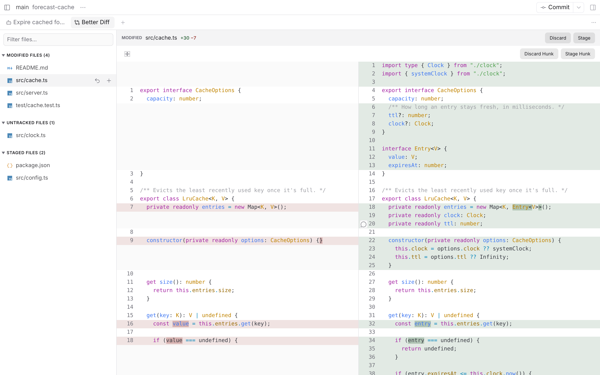
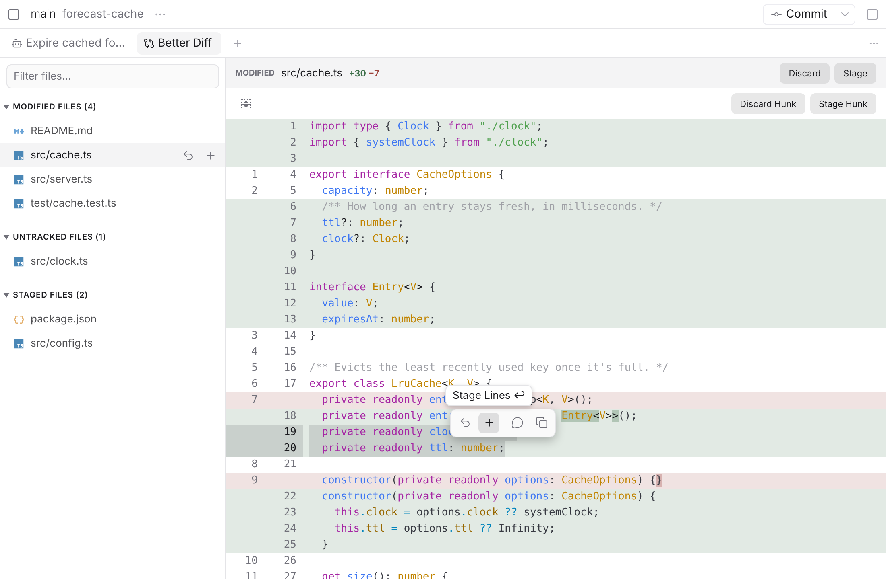
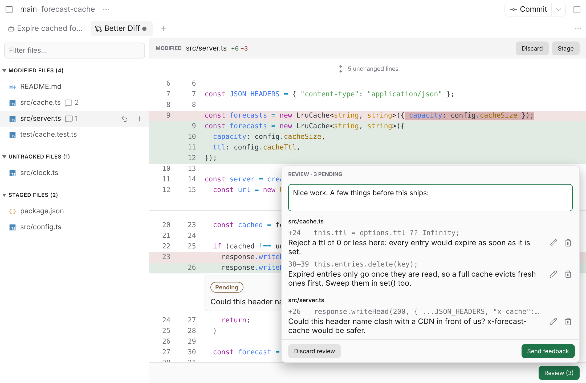
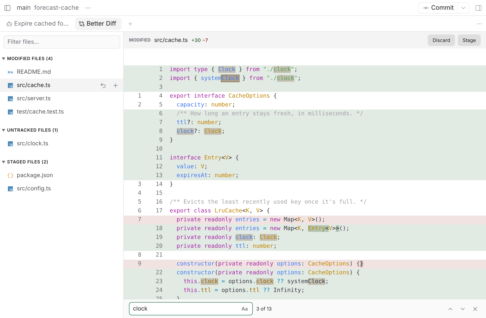

# Better Diff

A [Paseo](https://paseo.sh) plugin: a Sublime Merge-style diff and staging view for a workspace's worktree, made for reviewing what agents change.

<picture>
  <source media="(prefers-color-scheme: dark)" srcset="docs/screenshots/side-by-side-dark.png">
  
</picture>

> [!WARNING]
> This project is completely vibe coded. It's checked by property tests against real git, mutation testing in which a test has to catch every mutant, end-to-end tests in Paseo's UI, and strict type checking and linting.

## Features

### Read every change

Diffs are syntax highlighted, with the words that changed within a line highlighted, as delta does. They're side by side where the panel has room for your line length, and inline where it hasn't, or always one or the other, as you set it. The panel refreshes as agents change the worktree, without moving the view.

### Stage exactly what you mean to

Stage, unstage and discard whole files, hunks or selected lines. Select lines with the pointer or the keyboard, and their actions show in a bar right over them.

<picture>
  <source media="(prefers-color-scheme: dark)" srcset="docs/screenshots/lines-dark.png">
  
</picture>

### Review what agents change

Comment on a line, or on several, as you read. Comments stay pending, as in a GitHub review, until you look them over and send them, with a message of your own, to an agent in the workspace, or to a new one.

<picture>
  <source media="(prefers-color-scheme: dark)" srcset="docs/screenshots/review-dark.png">
  
</picture>

### Find in the diff

⌘F, or Ctrl+F off a Mac, finds in the open file's diff, or in all of a group's, lines the view hasn't rendered yet included. Smart case, as in ripgrep.

<picture>
  <source media="(prefers-color-scheme: dark)" srcset="docs/screenshots/find-dark.png">
  
</picture>

### Keyboard first

Everything works from the keyboard as well as the pointer: the arrows move between files, hunks and lines, Enter stages, Backspace discards, and Shift widens either to the whole file. Rest the pointer on a button for a second to see its key. Better Diff's page under Settings → Plugins lists them all.

### Even more

- Hide whitespace changes, and show unchanged lines around a hunk or the entire file.
- Handles renames, mode changes, binary files and symlinks. Generated files and large diffs are collapsed.
- Ignores untracked files in a `.gitignore`, `.git/info/exclude` or your global excludes file.

The full behaviour is in [SPEC.md](SPEC.md).

Syntax highlighting comes from Paseo's highlighter, [`@getpaseo/highlight`](https://github.com/getpaseo/paseo/tree/main/packages/highlight), and file icons from the set [Paseo's Changes tab](https://github.com/getpaseo/paseo/blob/main/packages/app/src/components/material-file-icons.ts) has. For a missing language or icon, open an issue with [Paseo](https://github.com/getpaseo/paseo/issues), not here.

Needs Paseo 0.14 or later.

```sh
paseo plugin add https://github.com/jozuas/better-diff
```

## Limitations

- Paseo's mobile app isn't supported.
- No history, branches or other git operations beyond staging: planned for v2. Commit from Paseo itself.
- No GitHub pull request reviews: planned for v3.
- Merge conflicts aren't handled: a conflicted file shows "Merge conflicts" instead of its diff.
- Submodules aren't supported.

## Inspiration / credits

Better Diff borrows heavily from these, and ports some of their code outright:

- [Sublime Merge](https://www.sublimemerge.com/)
- [Linear reviews](https://linear.app/docs/diffs)
- [Magit](https://magit.vc/)
- [lazygit](https://github.com/jesseduffield/lazygit)
- [delta](https://dandavison.github.io/delta/)
- [GitHub](https://github.com/)
- [VS Code](https://code.visualstudio.com/)

## Contributing

Pull requests aren't accepted. Please open an issue instead, well written and reproducible: the steps that cause the problem, what you expected, what happened, and your Paseo version.

## License

[MIT](LICENSE).
